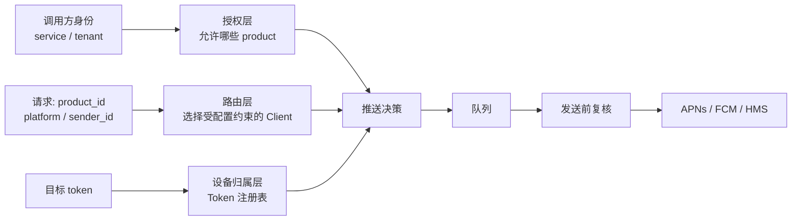

> 在上一篇 [gorush]() 里，我们把它定位为统一推送网关。但单套 APNs / FCM 凭据只适合单产品：一旦多个 App 共用网关，**「拿哪套凭据发送」与「允许向哪些设备发送」就成了两件必须明确建模的事。** 本文基于一份多产品推送方案做一次可落地的优化设计。核心结论：**`product_id + platform + sender_id` 只能选中客户端，不能证明目标设备归属；真正的隔离边界必须由经过认证的调用方身份与 Token 注册表共同执行。**

## 先说问题：单例客户端只能服务一个产品世界

原生 gorush 的配置只有顶层 `android` 和 `ios`，启动时各初始化一个全局 FCM Client 和 APNs Client：

```yaml
android:
  enabled: true
  key_path: "fcm-service-account.json"

ios:
  enabled: true
  key_path: "apns-key.pem"
  production: false
```

这个模型很干净，但它隐含了一个前提：整套服务只属于一个 Firebase Project 和一组 Apple 凭据。多产品场景立刻打破此前提：

- `app_a` 和 `app_b` 可能各有自己的 Firebase Project / Apple Team；
- 也可能共用同一 Firebase Project 或 Apple Team，却只允许推送各自的包名、Bundle ID 与设备；
- 一个产品还可能有海外、中国区等多套 sender；
- 调用方若只传任意 token，就可能借共享凭据跨产品推送。

最后一点最危险。`package_name`、APNs `topic` 只是请求中的普通字符串；调用方能伪造它们。**凭据共享时，不能把“调用方声称这是 app_a 的 token”当成授权事实。**

## 目标模型：路由、授权、投递三层分开

改造不能只是在 `PushNotification` 上多加几个字段。至少要把三层责任拆开：



三层缺一不可：

1. **路由**：`product_id + platform + sender_id` 选出哪一个 FCM / APNs Client；
2. **授权**：认证后的服务身份是否有权操作这个 `product_id`，以及允许使用哪些 sender、消息类型和发送速率；
3. **设备归属**：每个 token 是否确实属于这个产品、平台、sender 和应用标识。

请求里的字段只能参与路由，**不能单独构成授权依据**。这也是将“多产品”看成轻量多租户系统后最重要的设计变化。

## 配置改造：凭据可共享，策略不能共享

配置建议从顶层单例改为 `products → platform → senders`。同一份密钥文件可以被多个产品引用，但各产品自己的白名单必须独立声明：

```yaml
products:
  app_a:
    android:
      senders:
        firebase_main:
          key_path: "/run/secrets/firebase-main.json"
          package_names: ["com.company.appa"]
          max_retry: 2
    ios:
      senders:
        apple_team_main:
          key_path: "/run/secrets/AuthKey_MAIN.p8"
          key_type: "p8"
          key_id: "KEY_ID_MAIN"
          team_id: "TEAM_ID_MAIN"
          production: true
          topics: ["com.company.appa", "com.company.appa.widget"]

  app_b:
    android:
      senders:
        firebase_main:
          key_path: "/run/secrets/firebase-main.json" # 可共享凭据
          package_names: ["com.company.appb"]           # 不共享策略
    ios:
      senders:
        apple_team_main:
          key_path: "/run/secrets/AuthKey_MAIN.p8"
          key_type: "p8"
          key_id: "KEY_ID_MAIN"
          team_id: "TEAM_ID_MAIN"
          production: true
          topics: ["com.company.appb"]
```

这份配置表达两个不同概念：

- **sender credential** 是技术凭据：一个 Firebase service account、一个 APNs Key/证书；
- **product policy** 是业务边界：这个产品能使用哪一个 sender，能写哪些 Android 包名、哪些 APNs topic。

不要为了“减少重复”把 `package_names` / `topics` 提升到共享 credential 下。密钥可以共享，授权范围不可意外继承；否则 `app_a` 扩大白名单会无意间扩大 `app_b` 的可发送范围。

## 请求契约：显式指定 Sender，但服务端掌握最终字段

每条消息应强制带上 `product_id`、`sender_id` 与平台应用标识。以 Android 为例：

```json
{
  "notifications": [{
    "product_id": "app_a",
    "sender_id": "firebase_main",
    "platform": 2,
    "package_name": "com.company.appa",
    "tokens": ["fcm_token_001"],
    "title": "订单提醒",
    "message": "您的订单已发货",
    "data": {"order_id": "ORD-001"}
  }]
}
```

iOS 则以 `topic`（Bundle ID）作为应用标识：

```json
{
  "notifications": [{
    "product_id": "app_a",
    "sender_id": "apple_team_main",
    "platform": 1,
    "topic": "com.company.appa",
    "tokens": ["apns_token_001"],
    "push_type": "alert",
    "title": "新消息",
    "message": "您有一条未读消息"
  }]
}
```

`sender_id` 必须由调用方显式指定，网关不能悄悄遍历产品下全部 sender 进行广播。遍历会带来重复推送、成本不可控和事故难排查；“一次请求，一个明确投递路径”更适合审计、重放和限流。

但“显式传入”不等于“直接相信”。服务端必须执行：

- Android：校验 `package_name` 在该产品、该 sender 的 `package_names` 中；再由服务端写入 FCM `restricted_package_name`，不接受调用方下传的同名下游配置。
- iOS：校验 `topic` 在该产品、该 sender 的 `topics` 中；按照所选 sender 的 Key、Team 和 production 环境创建请求。
- 两端：`sender_id` 必须确实挂在该 `product_id + platform` 下，平台不匹配立即拒绝。

## 真正的安全边界：Token 注册表

即使服务端已经验证了 `app_a + firebase_main + com.company.appa`，攻击者或错误的上游仍可把 app_b 的 token 塞进来。共享 Firebase Project 时，service account 本身拥有的是 Project 级能力，包名字段只是下游限制，不能替代你的业务授权。

因此需要一个受认证的设备注册流程。客户端获取或刷新 token 后，连同归属元数据上报；服务端记录其绑定关系：

```text
token + product_id + platform + sender_id + package_name / bundle_id
```

推荐的数据模型如下。`token_hash` 用于等值检索，密文仅在必须发信时取回：

```text
device_tokens(
  id,
  token_hash, token_ciphertext, key_version,
  platform, product_id, sender_id,
  package_name, bundle_id,
  updated_at, revoked_at, expires_at
)

UNIQUE(token_hash, platform, product_id, sender_id)
INDEX(product_id, platform, sender_id, revoked_at)
```

实现上有几个比“存一个 hash”更关键的细节：

- 用带版本的 HMAC / pepper 计算 `token_hash`，而非无盐普通哈希；这样避免 token 值被离线枚举，同时支持密钥轮换。
- token 原文若需要再次推送，必须采用 KMS 管理的数据密钥加密；只存 hash 就无法把 token 交给 APNs/FCM。
- 注册接口本身必须认证 App 身份，例如登录态绑定、设备证明或可信后端签发的注册凭证。否则攻击者可以把别人的 token 注册到自己的产品下。
- token 会轮换、卸载和失效。注册应是幂等 upsert；下游返回明确的未注册/无效错误时应撤销，长期未刷新则过期清理。

发送前对每个 token 做归属过滤：iOS 要匹配产品、sender、Bundle ID 与 `topic`；Android 要匹配产品、Firebase sender 与 `package_name`。不匹配的 token 应在响应/事件中记录为 `token_not_owned`，绝不静默跨产品发送。

## 客户端池：从全局单例升级为受策略约束的资源池

原来的全局 `FCMClient` / `ApnsClient` 无法表达多 sender。改造后，Client Pool 的索引至少是：

```text
ClientKey = product_id + platform + sender_id
```

初始化阶段解析并校验完整配置，为每个合法键建立独立的发送适配器；iOS 每个键同时持有自己的并发限制。这里有一个容易被忽略的优化：**凭据解析可以去重，授权对象不能去重。** 两个产品引用同一 service account 文件时，可以复用底层认证材料或连接，但上层仍必须保留两个各自带 policy 的路由条目，不能因为“Client 指针相同”绕过产品边界。

一个清晰的处理顺序应是：

```text
认证调用方
  → 校验 product / platform / sender 配置
  → 校验调用方的产品权限与配额
  → 校验 topic / package_name 白名单
  → 查询并过滤 Token 注册表
  → 生成内部、不可由调用方伪造的 SendJob
  → 入队
```

对外 DTO 和内部 `SendJob` 不应复用。内部任务应保留已经解析的路由键、可信应用标识、被过滤后的 token 引用、请求 ID 与策略版本，避免消费者又从不可信 JSON 重新推断授权。

## 异步系统的补课：入队校验一次，发送前再校验一次

方案提出“两次校验”，这是必要的；原因不只是防御编码疏忽，而是队列天然会拉开时间。

一条消息入队后，可能发生：产品被停用、调用方权限被撤销、某个 token 被注销、APNs Key 被轮换、白名单收缩。若消费者只相信入队那一刻的结论，旧任务会穿透新策略。

建议采用“策略版本 + 发送前复核”的组合：

```text
入队：写入 policy_version、token 记录版本、request_id
消费：读取当前策略；版本变化或状态不再有效时重新授权/拒绝
发送：按当前有效 Client 和白名单执行
```

这也带来一个业务选择：紧急撤权追求强一致时，消费者应以当前策略为准；追求“已经受理即必发”时，可以允许策略快照继续发送。涉及跨产品隔离和密钥泄露时，应默认前者——**安全撤销优先于历史任务必达**。

## API 权限、幂等与审计：多租户网关的另外三道门

有了 token 表仍不够。推送 API 本身需要服务到服务的认证，例如 mTLS、JWT 或网关签名；身份主体应映射到允许的产品集合，而不是让任何持有 API Key 的调用方随便填写 `product_id`。

此外建议补三个基础能力：

| 能力 | 设计建议 | 解决的问题 |
|---|---|---|
| 幂等 | `Idempotency-Key` + 调用方 + 请求摘要，短期去重 | 网络重试造成重复推送 |
| 限流/配额 | 按调用方、产品、sender、消息类型分层限流 | 单产品挤占共享网关与厂商配额 |
| 审计 | 记录 request_id、主体、路由键、token 数、结果分类 | 发生越权或投诉时可追溯 |

审计日志不应记录完整 token 和敏感正文；记录 token 哈希前缀、数量、错误码和策略版本通常已经足够。通知内容若含验证码、订单或个人信息，应有单独的脱敏与保留期限策略。

## 改造落地顺序：先可兼容，再强制收口

这种改造跨配置、API、队列和数据存储，不适合一次切换。建议按以下阶段推进：

1. **扩展数据结构**：增加 `product_id`、`sender_id`、`package_name`，先保持旧单产品配置的兼容映射。
2. **引入产品配置与 Client Pool**：启动时完成 schema 校验；影子模式记录会选择到的路由，不改变实际投递。
3. **接入身份授权与 Token 注册表**：先观测 token 未注册/归属不符比例，再按产品逐步从告警切到拒绝。
4. **改造队列任务**：写入可信内部 `SendJob`、请求 ID 和策略版本，消费者启用二次校验。
5. **收紧旧接口**：要求所有生产请求携带三元路由键，移除“默认 sender”与跨产品回退逻辑。

每阶段都应有指标：按 `product_id + platform + sender_id` 观察接收量、过滤量、下游成功/失败、队列延迟和无效 token 比例。没有这些维度，出错时你仍然只能看到一条混杂的总失败数。

## 小结

多产品 gorush 改造的表面是配置树和客户端池，实质却是权限模型的升级。`product_id + platform + sender_id` 解决“用谁的凭据发”，白名单约束“请求声明要发给哪个应用”，Token 注册表回答“这个设备到底属于谁”，而调用方身份认证决定“谁有资格提出这次请求”。

把四者绑在一起，再让入队与消费两端都复核当前策略，才能在共享 Firebase Project、Apple Team 或基础设施的前提下保持产品隔离。推送网关至此不再只是协议适配器，而是一条可审计、可撤权、能承受异步延迟的多产品投递边界。
